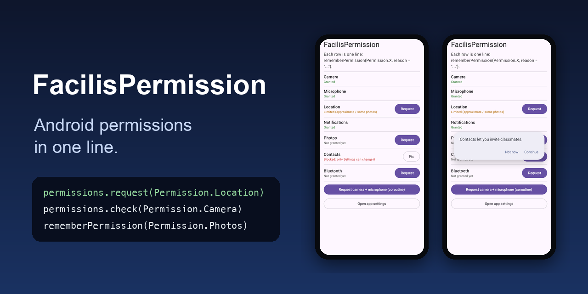

# FacilisPermission

[](https://jitpack.io/#al3j4ndrolm/FacilisPermission)
[](https://github.com/al3j4ndrolm/FacilisPermission/actions/workflows/build.yml)
[](LICENSE)

**Android runtime permissions in one line.** No `registerForActivityResult`, no version checks, no "don't ask again" bookkeeping.

<p align="center">
  
</p>

Part of the Facilis family, with [FacilisCam](https://github.com/al3j4ndrolm/FacilisCam) and [FacilisStorage](https://github.com/al3j4ndrolm/FacilisStorage).

```kotlin
permissions.request(Permission.Location) { granted -> }

if (permissions.check(Permission.Camera)) { ... }
```

Works from an Activity, Fragment, Compose or a ViewModel, even from a click handler. No `Context`, no `init()`.

## Jetpack Compose

```kotlin
val location = rememberPermission(Permission.Location, reason = "To find classes near you")

if (location.granted) Map() else Button(onClick = { location.request() }) { Text("Allow location") }
```

The state updates on its own when the user comes back from Settings.

## Coroutines and several at once

```kotlin
val granted = permissions.request(Permission.Camera, Permission.Microphone)
```

## Status

```kotlin
when (permissions.status(Permission.Location)) {
    PermissionStatus.Granted -> { }            // fully allowed
    PermissionStatus.Limited -> { }            // approximate location, or only some photos
    PermissionStatus.Denied -> { }             // asking again shows the system dialog
    PermissionStatus.PermanentlyDenied -> permissions.openSettings()
}
```

## Explain why

```kotlin
permissions.request(Permission.Contacts, reason = "Contacts let you invite classmates.") { granted -> }
```

- **First time:** just the system dialog.
- **After a denial:** your reason first, then the system dialog if the user taps Continue.
- **Blocked:** your reason with an **Open settings** button. The result comes back when the user returns.

## Supported permissions

Each one picks the right Android permissions for the device's Android version. Add the matching lines to your `AndroidManifest.xml` (only the ones you use):

| `Permission` | Manifest lines |
|---|---|
| `Camera` | `CAMERA` |
| `Microphone` | `RECORD_AUDIO` |
| `Location` | `ACCESS_FINE_LOCATION` and/or `ACCESS_COARSE_LOCATION` |
| `Notifications` | `POST_NOTIFICATIONS` (asked on Android 13+ only) |
| `Photos` | `READ_MEDIA_IMAGES`, optionally `READ_MEDIA_VISUAL_USER_SELECTED` (Android 14+ "some photos"), and `READ_EXTERNAL_STORAGE` with `android:maxSdkVersion="32"` |
| `Contacts` | `READ_CONTACTS` |
| `Bluetooth` | `BLUETOOTH_SCAN` and/or `BLUETOOTH_CONNECT` (asked on Android 12+ only) |

For example:

```xml
<uses-permission android:name="android.permission.ACCESS_FINE_LOCATION" />
<uses-permission android:name="android.permission.ACCESS_COARSE_LOCATION" />
```

Forgot one? `request` throws an error that lists the exact lines to add, instead of silently returning "denied".

## Install

Add JitPack to `settings.gradle.kts`:

```kotlin
dependencyResolutionManagement {
    repositories {
        google()
        mavenCentral()
        maven("https://jitpack.io")
    }
}
```

Then add one dependency (min SDK 23):

```kotlin
// Compose apps: rememberPermission, plus everything else
implementation("com.github.al3j4ndrolm.FacilisPermission:permission-compose:1.0.2")

// Views apps
implementation("com.github.al3j4ndrolm.FacilisPermission:permission:1.0.2")
```

## Good to know

- Requests run one at a time, and results arrive once your screen is resumed, so it's safe to navigate in the callback.
- Called before your screen is showing (from `onCreate` or a ViewModel's `init`), `request` waits for it, then asks.
- Called with nothing on screen or on its way (for example from the background), `request` can't show a dialog and answers right away with the current state.
- Before Android 13, notifications can't be requested: `Notifications` is `PermanentlyDenied` if the user turned them off, and `openSettings()` is the fix.
- Picking photos? Android's photo picker needs no permission at all. Use `Photos` only if you need to read the whole library.

## Contributing

```bash
./gradlew :permission:testDebugUnitTest :permission-compose:assembleRelease :sample:assembleDebug
```

`permission/` is the core library, `permission-compose/` the Compose helpers, and `sample/` a demo app with every permission.

## License

[MIT](LICENSE)
